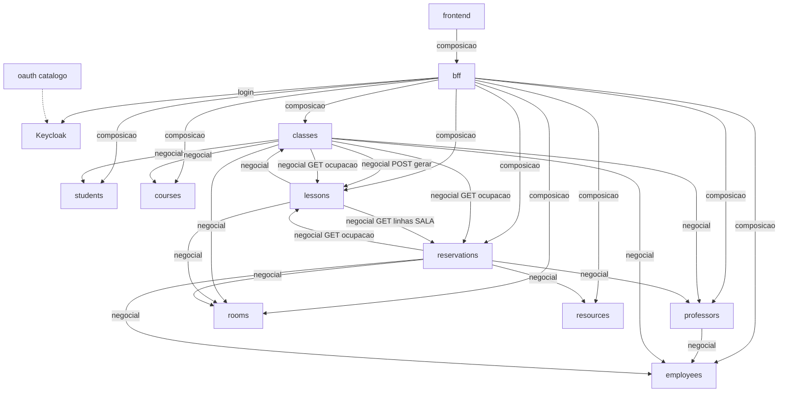
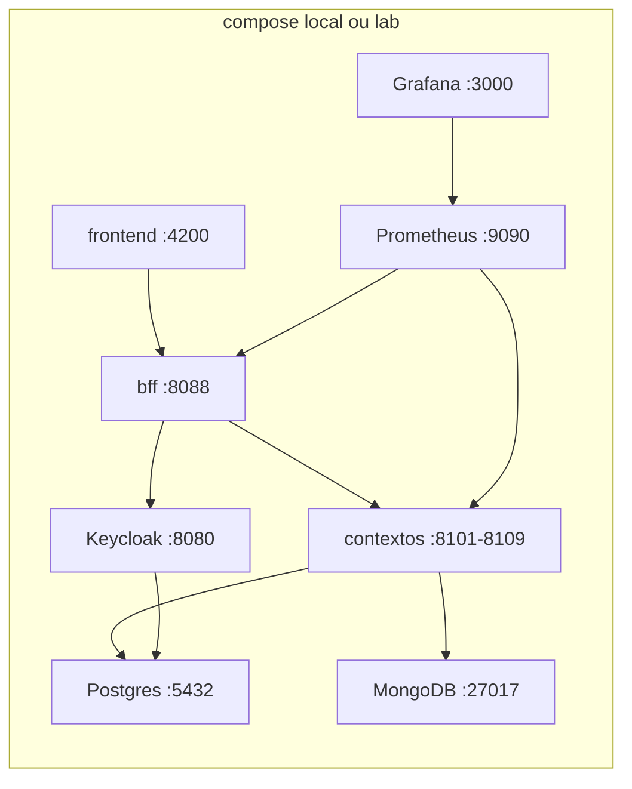
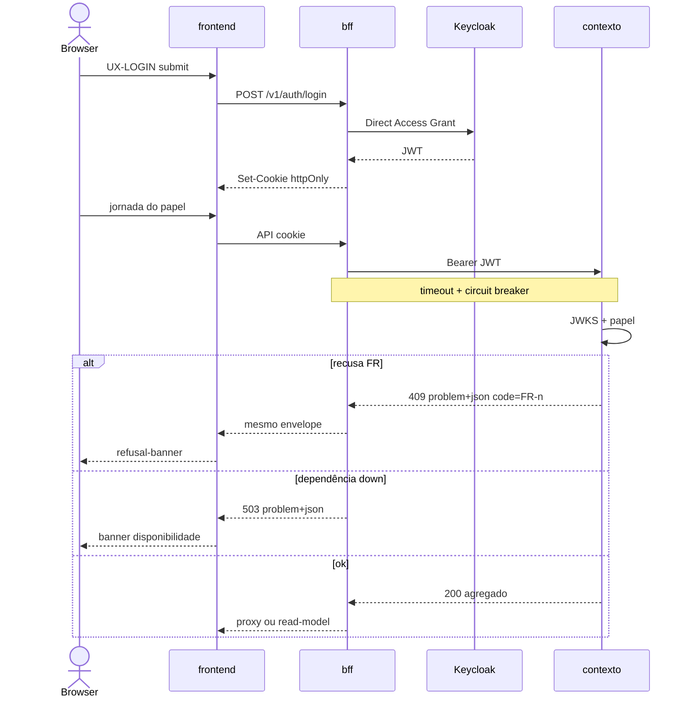

# Architecture Spine — Closed CRAS

Invariantes para nove grupos + agentes SDD implementarem em paralelo sem divergir em contrato, identidade, BFF, stores ou frontend. Glossário, UJs, telas e OQ-1 não se relitam aqui. Overrides OV-1…OV-10 (2026-10-14) emendam plataforma; invariantes de produto permanecem.

## Design Paradigm

**Malha de bounded contexts com BFF.** Cada contexto de domínio é unidade de contrato, de dados e de deploy. O BFF é a única composição voltada à UI e o único endpoint do browser. O módulo `oauth` não é um décimo domínio: é o catálogo do IdP e do gateway REST de identidade sobre Keycloak. A UI é **uma** SPA Angular com acesso por papel — não quatro produtos, não uma SPA por papel, não um seletor de serviço.

| Camada | Onde | Pode | Não pode |
| --- | --- | --- | --- |
| IdP | Keycloak (submódulo `oauth`) | emitir JWT do realm `closed-cras` | ser chamado pelo browser |
| Contextos (9) | `backend/<contexto>` | persistir o próprio par 1–N; resource-server; linguagem/store poliglotas | copiar cadastro alheio; CORS de SPA; embutir join de tela no agregado |
| Catálogo oauth | `backend/oauth` | realm, faixas, papéis/escopos, fragmento OpenAPI, adapters de referência | dono exclusivo de grupo; única linguagem obrigatória |
| BFF | `backend/bff` | login de browser, cookie, proxy + read-models de composição, rotas por módulo | dono de agregado; recalcular `salaEfetivaId`; motor de regra negocial; vazar roster em reserva |
| UI | `frontend` | superfícies UX-*; tokens de `DESIGN.md` sobre Material | join de nove OpenAPIs; adapter JS ao IdP |

## Invariants & Rules

### AD-1 — Direção de dependência da malha [ADOPTED]

- **Binds:** os 9 contextos, `bff`, `oauth`, `frontend`, NFR-CTR-1, NFR-CTR-2, OV-1, OV-10
- **Prevents:** UI falando com domínio; BFF persistindo agregado ou validando invariante negocial; `classes` copiando Room; ciclo de escrita `lessons` ↔ `reservations`; domínio embeber join de tela; BFF recalcular sala efetiva
- **Rule:** setas abaixo são as únicas dependências de runtime permitidas, em duas classes: **negocial** (domínio→domínio na escrita/validação) e **composição** (BFF→domínios na leitura/orquestração de vista). IDs alheios são atributos, não terceira classe. Escrita obedece NFR-CTR-2. A **única** criação em massa de Lesson é `POST /v1/lessons/gerar` chamado por `classes` após FR-13/FR-15 (AD-9) — efeito colateral **negocial**, não join de UI. `lessons` persiste o agregado; professor só altera Lesson já existente. `classes` e `reservations` fazem GET em `employees` (campo `ativo`, OQ-2). `oauth` não é chamado como serviço de domínio. Ciclo `lessons` ↔ `reservations` só em GET, profundidade 1. Browser fala **somente** com o BFF (OV-1). Orquestração BFF→domínios é HTTP síncrono com resilience (AD-10).

**Classificação OV-10 (canônica na altitude initiative):**

| Dependência | Tipo | Onde resolve | Exemplo |
| --- | --- | --- | --- |
| `professors` → `employees` | negocial | `professors` | Professor is-a Employee; create recusa sem Employee **ativo** (FR-4/FR-5) |
| `classes` → Course/Professor/Room/Student IDs | negocial | `classes` | abertura FR-13/FR-15; refs por `id` |
| `classes` → `employees.ativo` | negocial | `classes` | FR-1a (Class RO) |
| `classes` → `POST /v1/lessons/gerar` | negocial | `classes` → `lessons` | AD-9; não é join de tela |
| `classes`/`reservations` → GET ocupação | negocial | escritor | merge conflito AD-5 |
| `lessons` → Class / Room / linhas SALA | negocial | `lessons` | deriva e publica `salaEfetivaId` (AD-5) |
| `reservations` → Room/Resource/Professor/`employees.ativo` | negocial | `reservations` | FR-23/24/30 + FR-1a |
| BFF Class+Lessons (+ Room nome) | visualização | BFF | read-model; consome `salaEfetivaId` já resolvido |
| BFF ocupação FR-29 | visualização | BFF `modules/ocupacao` | une salas efetivas + SALA ad hoc + RECURSO; sem roster |
| BFF Student FR-19 | visualização | BFF módulo `lessons` | onde/quê/avaliação |
| BFF plano + roster FR-31 | visualização | BFF módulo `classes` | só Class atribuída; nunca em `reservations` |
| BFF proxy CRUD de domínio | passthrough | BFF | sem regra nova; envelope AD-2 |
| BFF display name Employee em vista Professor | visualização | BFF | `[ASSUMPTION]` OQ-ARCH-2 |

**Não classificar como “só visualização”:** merge de conflito sala efetiva / Professor / Resource nos escritores; derivação de `salaEfetivaId`; validação `employees.ativo` em `professors`/`reservations`/`classes`; `POST /v1/lessons/gerar`. Na dúvida de mutação/invariante → domínio; na dúvida de join só para tela → BFF.

**Anti-padrões:** BFF validando “Employee ativo” no lugar de `professors`; UI ou BFF inventando lista de Lessons como fonte da verdade da Class; `classes` embutindo payload completo de Lesson no agregado “para a tela”; duplicar a fórmula de sala efetiva no BFF.



### AD-2 — Fio compartilhado: OpenAPI, IDs, data+faixa, recusa [ADOPTED]

- **Binds:** FR-25, FR-13, FR-15, FR-23, FR-24, FR-30, FR-4, FR-11, NFR-CTR-3, NFR-CTR-4, SM-5
- **Prevents:** `/funcionarios` vs `/employees`; `pessoa`/`evento`/`slot`; datetime solto; envelope ad hoc com campo `message`; UI decidindo colisão; store vazando no contrato; `professorId` confundido com `employeeId`; agregado de domínio embutindo join de outro contexto
- **Rule:** cada contexto publica OpenAPI 3.1 YAML como fonte da verdade em `openapi/openapi.yaml` (spec 3.2.0 existe; pin 3.1 por tooling). Paths: `/v1/...` com o nome inglês do submódulo. Propriedades JSON usam tokens do glossário. IDs **emitidos** pelo Closed CRAS = UUID v4 (string). `Student.id` é string opaca do seed/import — não remintar (FR-7). `Course` tem `id` UUID **e** `codigo` alinhável (FR-10). `professorId` = id do agregado Professor; `employeeId` = id do Employee — nunca alias um do outro. IDs no contrato são sempre string — o store (PG/Mongo) não vaza. OpenAPI de domínio expõe **refs por id** (e campos derivados do próprio contexto, ex. `salaEfetivaId`); **proibido** embutir payload completo de outro contexto (ex. objeto `room` aninhado em Lesson “para a tela” — isso é read-model BFF). `faixaId` = código do cânone A–E, F–N, P. `backend/oauth/contracts/faixas.json` é a única cópia canônica (não duplicar enum nos nove repos). WeeklySlot: dia seg–sáb. O par data+faixa é dois campos (`data` = `YYYY-MM-DD`, `faixaId`); intervalo fechado-aberto. Lista JSON: propriedade `items`; sem paginação na v1. Recusas de invariante: `application/problem+json` (RFC 9457) com `code` = id do FR, `type` = `urn:closed-cras:recusa:<code>`, status 409 (422 só validação de forma). A UI mapeia `code` para `refusal-banner`. Versionamento additive sob `/v1`.

### AD-3 — Conformidade poliglota (linguagem + store) [ADOPTED]

- **Binds:** os 9 contextos, `bff`, `frontend`, `oauth`, OV-2, OV-4
- **Prevents:** BFF em duas linguagens; módulo `oauth` só como `.jar`; lista fechada Spring\|Nest como única linguagem permitida; store vazando no contrato; schema/database compartilhado entre contextos; identidade Mongo=Employee no lugar de `employeeId`
- **Rule:** linguagem/framework de cada API de domínio é livre **desde que** o checklist de conformidade passe. Persistência poliglota: cada contexto escolhe **PostgreSQL ou MongoDB** (um store por contexto; isolamento `cras_<contexto>`). Professor is-a Employee **somente** via `employeeId` 1–1 — não identidade de documento Mongo = Employee. O que é compartilhado está pinado na tabela Stack e não se troca por grupo.

**Checklist de conformidade (não negociável):**

1. OpenAPI 3.1 em `openapi/openapi.yaml`
2. Paths `/v1/<contexto>` + tokens do glossário
3. Listas com `items`
4. RFC 9457 com `code=FR-*`
5. JWT via JWKS + `GET /v1/identidade/me` (schema do fragmento oauth)
6. Par `data` + `faixaId`; faixas só em `oauth/contracts/faixas.json`
7. Direção de escrita AD-1; sem ciclo de escrita `lessons` ↔ `reservations`
8. IDs de contrato = string; store não aparece no OpenAPI
9. `GET /health` + readiness; métricas scrapáveis (AD-7/AD-12)
10. Seed idempotente sem CPF (AD-12); testes das camadas AD-11

`[ASSUMPTION]` BFF em NestJS (não Spring) — composição TypeScript; um runtime. Starters Spring Boot / Nest / outros são **exemplos**, não lista fechada. Seeds recomendados (não exclusivos): Spring Boot 4.1.x (Java 21) ou NestJS 12.x.

> **Conflito upstream (handoff `bmad-spec`):** SPEC Constraints (PostgreSQL only; paved Spring Boot 4.1.x **ou** NestJS 11.2.x — sem FastAPI/.NET/Express solto), non-goal “MongoDB para professors”, e `brownfield-2026-1.md` (“Professor em MongoDB… rejeitar”; “FastAPI/.NET/Express solto”) contradizem OV-2/OV-4. Spine prevalece para plataforma; refresh do companion é obrigatório.

### AD-4 — Gateway REST de identidade `[ASSUMPTION]` fluxo de laboratório

- **Binds:** FR-27, UX-LOGIN, os 9 contextos, `bff`, `oauth`, OV-3
- **Prevents:** adapter JS da UI ao Keycloak; nove endpoints de login; um grupo dono do IdP; token em `localStorage`; UI chamando o IdP; provisionar Employee→Keycloak na create; usar o adapter Node.js do Keycloak (DEPRECATED — usar OIDC/JWKS genérico)
- **Rule:** AuthN/AuthZ por roles via REST API OAuth em `backend/oauth` **sobre** Keycloak. Divisão: **oauth** = realm, roles/scopes, faixas, identity-gateway OpenAPI, adapters de referência; **BFF** = login browser, cookie httpOnly SameSite=Lax, propagação `Authorization: Bearer`; **domínios** = resource-server JWKS + `GET /v1/identidade/me` com o mesmo schema (`sub`, `email`, `papeis`, `employeeId`, `professorId`, `studentId`). Papéis v1 (strings literais do realm, sem prefixo `ROLE_` no contrato): `funcionario`\|`coordenador`\|`professor`\|`student`. `keycloak-js` **é proibido aqui** (o pacote ainda existe e é mantido — não é “deprecated”; a proibição é arquitetural). Adapters de referência em `oauth` são o padrão normativo de validação JWKS para os paved paths seed; qualquer outra linguagem deve equivaler ao mesmo contrato. `POST /v1/auth/login` no BFF usa Direct Access Grant do client confidencial `bff` no realm `closed-cras`. Credencial recusada: 401 sem enumerar. BFF/IdP down: 503; UI banner, sem fallback ao IdP. Federação CAFe/BAITA fora da v1. `[ASSUMPTION]` Direct Access Grant (não Authorization Code) para o `login-panel`.

### AD-5 — Sala efetiva em `lessons`; conflito no escritor [ADOPTED]

- **Binds:** FR-13, FR-16, FR-18, FR-19, FR-23, FR-24, FR-29, FR-30, UJ-2, UJ-4
- **Prevents:** BFF ou UI calculando sala efetiva; 18 reservas da sala padrão; `reservations` persistindo a derivação; ocupação só a partir de Reservation; FR-13 recusando Recurso; dois módulos BFF donos de FR-29
- **Rule:** `lessons` é o único dono da derivação. Presencial sem linha SALA → `salaEfetivaId` = `Class.roomId`. Presencial com `ReservationLine.kind=SALA` daquela `lessonId` → `salaEfetivaId` = `targetId` e a sala padrão fica livre naquela data+faixa. Remoto → `salaEfetivaId` nulo **mesmo se** existir linha SALA; `lessons` não apaga Reservation (o professor cancela via FR-30). GET de Lesson e `GET /v1/lessons/ocupacao?data=&faixaId=` devolvem `salaEfetivaId` já resolvido e leem `rooms` por esse id (sem embutir Room no agregado persistido). `GET /v1/lessons/ocupacao` inclui `lessonId`, `professorIds` (ids de Professor, não Employee), `modalidade` — **sem** Resource. `GET /v1/reservations/ocupacao?data=&faixaId=` devolve `reservationId`, `professorId` (Professor), `lessonId` (ausente se ad hoc), `kind`, `targetId`. **Universo de merge (obrigatório, mesmos conjuntos):** FR-13 usa union de salas (`lessons.salaEfetivaId` ∪ `reservations` kind=SALA) e union de professores (`lessons.professorIds` ∪ `reservations.professorId`); Recurso **não** entra; FR-15 à parte via GET `rooms` (capacidade ≥ vagas e ≥1 AccessibilityFeature). FR-23/24/30 usam o mesmo union de sala e professor **mais** Recurso tomado/inativo (só linhas RECURSO); no máximo uma linha SALA por `lessonId`; SALA exige capacidade/a11y da Room (ad hoc: capacidade > 0 e ≥1 feature). Cancelar Reservation (FR-30) libera a faixa e restaura sala efetiva à padrão via rederivação em `lessons`. FR-29 (BFF, AD-6) une salas efetivas + SALA ad hoc + RECURSO; nunca `studentIds`. OV-10 **não** enfraquece esta AD.

### AD-6 — Browser só no BFF; composição de leitura; LGPD [ADOPTED]

- **Binds:** FR-19, FR-26, FR-29, FR-31, NFR-LGPD-1–4, UX-S7, UX-S8, UX-S9, OV-1, OV-10
- **Prevents:** join de nove OpenAPIs no browser; CORS de SPA nos contextos; roster em Reservation; BFF como motor de regra negocial (incl. validar `employees.ativo`/FR no proxy); dois donos BFF de FR-29/FR-19
- **Rule:** só o BFF configura CORS para a origem do `frontend` com credentials. Contextos **não** habilitam CORS de SPA (browser não os chama). Contrato público: `backend/bff/openapi/openapi.yaml` (OpenAPI 3.1, envelope AD-2). Distinguir no OpenAPI BFF: **proxy** (CRUD/pass-through sob paths espelhando `/v1/<contexto>/...`, sem regra FR adicional) vs **read-model de composição** (OV-10 visualização; paths próprios, ex. ocupação/FR-19/FR-31). Proxy **repassa** status/problem+json do domínio; não pré-valida invariantes negociais. Cada grupo adiciona o próprio domínio em `backend/bff/src/modules/<contexto>/`. FR-29 só em `modules/ocupacao/`. FR-19 só no módulo `lessons` do BFF (Student vê só sala efetiva — nunca a padrão quando diverge). Módulo `reservations` do BFF **não** inclui `Class.studentIds`. Roster só no módulo `classes` (UX-S8 / FR-31) da Class atribuída; AcademicAffiliation ≠ roster. Sem CPF na v1. NFR-LGPD-4: não apagar `id` canônico. Read-models consomem AD-5; não recalculam sala efetiva.

### AD-7 — Envelope operacional de laboratório [ADOPTED]

- **Binds:** NFR-Q-1, NFR-Q-2, demo ConstrSW, OV-4, OV-9
- **Prevents:** Kubernetes/Helm na v1; um schema/database compartilhado entre contextos; IdP SaaS; sensores no caminho crítico; omitir métricas scrapáveis
- **Rule:** um Docker Compose na raiz sobe: Keycloak `start-dev`, PostgreSQL 18.x (databases `cras_<contexto>` para contextos PG + Keycloak), MongoDB 8.x (databases `cras_<contexto>` para contextos Mongo), os nove serviços, BFF, frontend Angular, Prometheus, Grafana. Ambiente `local` = compose na máquina; `lab` = mesmo compose em VM. `GET /health` anônimo + readiness em BFF e contextos. Endpoint de métricas scrapável (seed `/metrics`) em todo serviço. Logs estruturados em stdout. Ocupação v1 é **agendada** (FR-29), não sensor.

### AD-8 — UI web única Angular + Material [ADOPTED]

- **Binds:** FR-28, UX-LOGIN, UX-HOME, UX-S1–UX-S9, `DESIGN.md`, `EXPERIENCE.md`, OV-6
- **Prevents:** quatro SPAs; SPA por papel; tema Material default sem tokens; React/Vite/TanStack como stack UI; tela de alta de Student; seletor de microsserviço; grupo implementando a tela do próprio contexto; `keycloak-js`
- **Rule:** um app Angular SPA (sem SSR competindo com o BFF). `src/shell` = UX-LOGIN, UX-HOME, `app-shell` e `role-nav` em todas as rotas autenticadas. Superfícies: `src/surfaces/ux-s1` … `ux-s9` (no máximo um grupo por UX-S*). Frontend cruzado (FR-28); emparelhamento = OQ-1. Dados só via BFF. Angular Material permitido como kit; tokens de `DESIGN.md` **prevalecem** (primary `#1E3A5F`; accent `#C45C26` só sala efetiva divergente; IBM Plex Sans/Mono; v1 light-only). Sessão ausente/expirada ou logout → UX-LOGIN. URL de outro papel → UX-HOME do papel atual. Credencial recusada: banner no `login-panel`. BFF/IdP/domínio crítico down: banner (AD-10). Até OQ-3 fechar, LessonTopic exige pelo menos um de `syllabusItemId` ou enunciado extra.

> **Conflito upstream (handoff `bmad-spec`):** SPEC Constraints / CAP-12 e companion antigo pinavam React+Vite (+ TanStack Query). OV-6 substitui por Angular + Angular Material. Pins Keycloak/Nest do SPEC (26.7.x / 11.2.x) ficam stale frente à Stack desta spine.

### AD-9 — Geração de Lesson e imutabilidade da data+faixa [ADOPTED]

- **Binds:** FR-13, FR-14, FR-16, `classes`, `lessons`
- **Prevents:** `classes` e `lessons` cada um inventando o POST de criação; regenerar esqueleto; editar data+faixa da Lesson na v1; tratar gerar como join de UI (OV-10)
- **Rule:** depois de FR-13 e FR-15 confirmados, só `classes` chama `POST /v1/lessons/gerar` com `classId`. `lessons` cria uma Lesson por par (dia, faixa) no intervalo início/fim da Class (WeeklySlot seg–sáb; feriados **não** excluídos na v1). `data` e `faixaId` da Lesson são imutáveis. Correção de oferta = nova Class. Professor não cria Class nem dispara gerar. OV-10 classifica esta seta como **negocial**.

### AD-10 — Resilience em hops HTTP [ADOPTED]

- **Binds:** BFF→domínios; GETs domínio→domínio do AD-1; OV-5; UX banners
- **Prevents:** cascata sem breaker; retry ilimitado em POST não idempotente; 500 opaco no lugar de 503 estável; UI sem banner em falha crítica
- **Rule:** todo hop BFF→domínio e todo GET domínio→domínio da malha AD-1 aplica **timeout** + **circuit breaker**; **retry** só com política explícita (métodos/operações idempotentes; backoff limitado). Falha crítica de dependência → `503` + `application/problem+json` estável (`code` de infraestrutura da malha, não inventar FR de produto). UI mostra banner; sem fallback ao IdP nem bypass ao domínio. Libs na Stack são seed; o comportamento é a invariante.

### AD-11 — Camadas de teste obrigatórias [ADOPTED]

- **Binds:** FR-25, UJ-1…UJ-4, OV-7, CI da malha
- **Prevents:** só teste manual; contrato OpenAPI sem verificação; E2E omitindo UJs
- **Rule:** cada unidade (9 + oauth + BFF + frontend) entrega: (1) unit/component; (2) testes de contrato alinhados ao OpenAPI na fronteira BFF↔domínios (e fragmentos oauth); (3) suíte executável em CI de regressão; (4) E2E cobrindo UJ-1…UJ-4 na UI contra a malha compose. Framework por linguagem = seed (JUnit/Jest/Vitest/Playwright etc.); as **camadas** são a invariante.

### AD-12 — Fixtures e seed de laboratório [ADOPTED]

- **Binds:** UJ-1…UJ-4, conflitos FR, OV-8, CAP-3 Student seed
- **Prevents:** massa ad hoc não versionada; CPF em fixture; seed que provisiona Keycloak na create Employee; fixtures que quebram idempotência
- **Rule:** cada REST API (9 + oauth + BFF) versiona fixtures/seed idempotentes (reaplicáveis sem duplicar agregados). Sem CPF. Cobertura mínima: jornadas UJ-1…UJ-4 e casos de recusa FR dos escritores. Student continua seed/import (sem tela de alta). oauth seed = realm/users/clients de lab — separado da create de Employee.

## Consistency Conventions

| Concern | Convention |
| --- | --- |
| Naming | Submódulo e path = inglês do contexto. JSON e UI = tokens do glossário. OpenAPI `info.title` = nome do contexto. |
| Data & formats | UUID v4 só para ID emitido; Student.id opaco; Course.codigo além do id; IDs = string no contrato; `data` date-only; `faixaId` cânone; lista com `items`; RFC 9457; JSON camelCase; UTF-8 |
| State & cross-cutting | Mutação no contexto dono; BFF sem persistência de agregado; composição de leitura só no BFF (OV-10); JWT Bearer serviço-a-serviço (token do usuário); sem barramento de eventos na v1; config por env (`DATABASE_URL` ou `MONGODB_URI`, `KEYCLOAK_JWKS_URL`, `BFF_ORIGIN`) |
| AuthZ | Quatro papéis de realm; gateway de cada contexto recusa escrita fora de NFR-CTR-2; Student sem rota de escrita |
| Equidade | Uma principal + uma secundária 1–N. IDs alheios = atributos. Professor não copia nome/e-mail. Todo Professor é Employee via `employeeId` 1–1; nem todo Employee é Professor. |
| Employee | E-mail institucional único (ativos e inativos); desativar não apaga vínculos nem registro; sem delete físico; sem provisionar Keycloak na create |
| Student | Seed/import JSON idempotente por `id` em `students`; `Class.studentIds` no mesmo fluxo; AcademicAffiliation ≠ roster; sem tela de alta |
| OQ-2 | Employee desativado: Class somente leitura; nova Reservation recusada. Escritores consultam `employees.ativo` (**negocial**, não BFF). |
| OQ-3 (default até fechar) | LessonTopic: pelo menos um de `syllabusItemId` ou enunciado extra |
| LGPD | Cadastro administrativo em escopo; sem CPF v1; não apagar id canônico |
| SDD cold-start | Esqueletos OpenAPI + fragments compartilhados; OpenAPI BFF (proxy vs read-model); catálogo oauth; compose completo; bootstrap submódulo (health, metrics, seed, testes); catálogo `code` FR-*; versionamento additive `/v1` |

## Stack

Verificado na web em 2026-10-14. Código passa a ser o dono depois do cold-start. OpenAPI 3.2.0 é o spec vigente; contratos pinam 3.1. Angular 22 exige TypeScript `>=6.0.0 <6.1.0` no frontend; BFF Nest pode divergir de TS dentro do range do Nest 12.

| Name | Version |
| --- | --- |
| OpenAPI Specification (contratos) | 3.1 |
| Java (seed Spring) | 21 |
| Spring Boot (seed domínio) | 4.1.1 |
| springdoc-openapi | 3.1.1 |
| resilience4j-spring-boot4 (seed Spring) | 2.4.0 |
| mongodb-driver-sync (seed Java) | 5.13.0 |
| Node.js (FE/BFF) | 24.x (>=24.15) |
| NestJS (`@nestjs/core`, BFF) | 12.1.3 |
| @nestjs/resilience (seed BFF) | 0.0.2 |
| Express (seed Nest platform) | 5.2.x |
| TypeScript (frontend Angular) | 6.0.x |
| mongodb (seed Node driver) | 7.7.0 |
| Keycloak | 26.8.1 |
| Keycloak image | quay.io/keycloak/keycloak:26.8.1 |
| PostgreSQL | 18.6 |
| MongoDB image | mongo:8.3.13 |
| Angular (`@angular/core`) | 22.2.2 |
| Angular Material | 22.2.3 |
| @angular/cdk | 22.2.3 |
| @fontsource/ibm-plex-sans | 5.3.0 |
| @fontsource/ibm-plex-mono | 5.3.0 |
| Prometheus | 3.15.0 |
| Grafana (OSS image) | 13.2.4 |
| Docker Compose | v2 |

## Structural Seed

```text
constrsw-2026-2/                  # malha (este repo); compose.yaml na raiz
  backend/oauth/                  # realm, faixas.json, roles-scopes.yaml, openapi/identity-gateway.yaml, adapters/*
  backend/employees/              # um git repo por contexto (submódulo)
  backend/professors/
  backend/students/
  backend/courses/
  backend/rooms/
  backend/resources/
  backend/classes/
  backend/lessons/
  backend/reservations/
  backend/bff/                    # NestJS; modules/<contexto>/; modules/ocupacao/; modules/auth/
  frontend/                       # Angular SPA + Material
    src/shell/                    # UX-LOGIN, UX-HOME, app-shell, role-nav
    src/surfaces/ux-s1 … ux-s9/
    src/theme/tokens.css          # DESIGN.md prevalece sobre tema Material
```

Portas seed do compose (host):

| Unidade | Porta |
| --- | --- |
| Keycloak | 8080 |
| PostgreSQL | 5432 |
| MongoDB | 27017 |
| employees | 8101 |
| professors | 8102 |
| students | 8103 |
| courses | 8104 |
| rooms | 8105 |
| resources | 8106 |
| classes | 8107 |
| lessons | 8108 |
| reservations | 8109 |
| BFF | 8088 |
| frontend | 4200 |
| Prometheus | 9090 |
| Grafana | 3000 |





## Capability → Architecture Map

| Capability / Area | Lives in | Governed by |
| --- | --- | --- |
| FR-1, FR-2 Employee + EmploymentBond | `employees` + BFF módulo + UX-S1 | AD-1, AD-2, AD-6 |
| FR-3, NFR-ID-1/2 identidade não copiada | consumidores guardam IDs | AD-1, AD-2, AD-3 |
| FR-4, FR-5, FR-6 Professor is-a + AcademicDegree | `professors` (exige `employeeId` ativo) + UX-S2 | AD-1 OV-10, AD-4 |
| FR-7, FR-8, FR-9 Student seed + affiliation; roster em Class | `students` import; `classes.studentIds` | AD-1, AD-8, AD-12 |
| FR-10, FR-11, FR-12 Course + plano + SyllabusItem | `courses` + UX-S5 | AD-1, AD-2 |
| FR-13, FR-14, FR-15 abrir Class + esqueleto + capacidade/a11y | `classes` escreve; GET ocupacao; GET rooms | AD-5, AD-2, AD-9, OV-10 |
| FR-16 gerar Lesson | `POST /v1/lessons/gerar` só via `classes` | AD-9, OV-10 negocial |
| FR-17, FR-18, OQ-3 Lesson + sala efetiva | `lessons` dono da derivação | AD-5 |
| FR-19 Student onde/quê/avaliação | BFF módulo `lessons` → UX-S9 | AD-5, AD-6 OV-10 |
| FR-20, FR-21 Room + AccessibilityFeature | `rooms` + UX-S3 zona Room | AD-1 |
| FR-22 Resource + InventoryItem | `resources` + UX-S3 zona Resource | AD-1 |
| FR-23, FR-24, FR-30 Reservation +/- cancelar | `reservations`; merge AD-5 | AD-5, AD-2 |
| FR-25 contract-first | `openapi/openapi.yaml` por contexto | AD-2, AD-3, AD-11 |
| FR-26, FR-29 ocupação data+faixa | BFF `modules/ocupacao` → UX-S4 | AD-5, AD-6 OV-10 |
| FR-27 gateway identidade | oauth + BFF login + resource-server nos 9 | AD-4 |
| FR-28 frontend cruzado | `frontend` superfícies; OQ-1 | AD-8 |
| FR-31 plano + roster | BFF módulo `classes` → UX-S8 | AD-6 OV-10 |
| NFR-LGPD-1–4 | BFF recortes + sem CPF v1 | AD-6, AD-12 |
| NFR-CTR-1–4 | direção AD-1; faixas AD-2 | AD-1, AD-2 |
| NFR-Q-1, NFR-Q-2 | compose + observabilidade; sem sensor | AD-7, AD-10 |
| UX-LOGIN, UX-HOME | `frontend/src/shell` + BFF `/v1/auth` | AD-4, AD-8 |
| UX-S1–UX-S9 | `frontend/src/surfaces`; OQ-1 | AD-8 |
| Resilience / métricas / seed / testes | todos os serviços | AD-10, AD-11, AD-12, AD-7 |

## Deferred

- **OQ-1** emparelhamento grupo ↔ UX-S1…S9 — turma/docente; a spine não atribui donos. A regra “não o próprio domínio” já vale (AD-8).
- **OQ-3** enunciado vs `syllabusItemId` obrigatório — grupo `lessons`. Default na AD-8 até fechar.
- **OQ-ARCH-1** qual contexto usa Mongo vs PG no cold-start — escolha por grupo no README do submódulo; compose sempre sobe ambos. `[ASSUMPTION]` até o bootstrap fixar defaults de lab.
- **OQ-ARCH-2** enriquecimento de display name Employee na vista Professor — default BFF (visualização).
- Arquitetura interna de cada serviço (hexagonal vs layered, ORM/ODM).
- Codegen OpenAPI — o YAML é a invariante.
- Detalhe interno de um único domínio (altitude epic).
- Barramento de eventos, saga, ocupação real/no-show, OneRoster/Edu-API.
- Authorization Code + PKCE e federação CAFe/BAITA.
- Escopos finos além dos quatro papéis de realm.
- Kubernetes, service mesh, observabilidade de cluster além de Prometheus+Grafana no compose.
- Esqueletos OpenAPI completos de produto (SDD gera a partir desta spine + SPEC).
- Java 25 LTS (permitido no range do Boot 4.1; pin da malha permanece 21).
