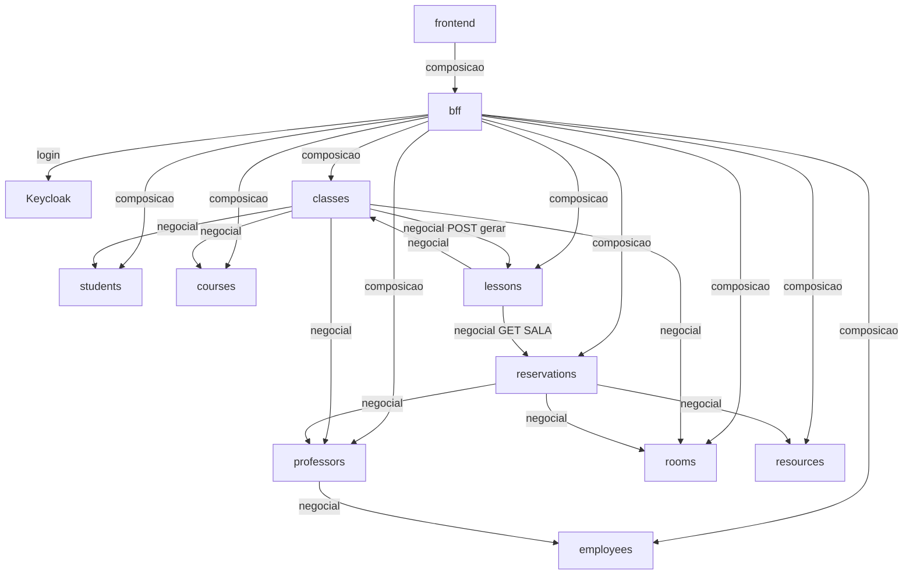

# Domain pairs — Closed CRAS

Matriz dos nove bounded contexts (equidade ConstrSW) e referências cross-service. Tokens do glossário do PRD.

## Pares 1–N

| Contexto | Principal | Secundária 1–N | Notas |
| --- | --- | --- | --- |
| `employees` | Employee | EmploymentBond | Cadastro-mestre; não dono de Room/Resource/Professor |
| `professors` | Professor | AcademicDegree | is-a Employee via `employeeId` 1–1; não copia nome/e-mail; store PG ou Mongo irrelevante à identidade |
| `students` | Student | AcademicAffiliation | Identidade recebida (seed); sem tela de alta |
| `courses` | Course | SyllabusItem | `kind`: conteúdo \| bibliografia \| critério; plano datado |
| `rooms` | Room | AccessibilityFeature | Prédio = texto; capacidade obrigatória |
| `resources` | Resource | InventoryItem | ≠ Room; `estado` v1: disponível \| indisponível |
| `classes` | Class | WeeklySlot | Sala padrão `roomId`; esqueleto seg–sáb + `faixaId` |
| `lessons` | Lesson | LessonTopic | Dona da `salaEfetivaId`; data/`faixaId` imutáveis |
| `reservations` | Reservation | ReservationLine | `kind`: SALA \| RECURSO; ad hoc sem `lessonId` |

IDs alheios são **atributos**, não terceira classe do par. `professorId` ≠ `employeeId`.

## OV-10 — Negocial vs visualização

| Dependência | Tipo | Onde resolve |
| --- | --- | --- |
| `professors` → `employees` (ativo, is-a) | negocial | `professors` |
| `classes` → Course/Professor/Room/Student; GET ocupação; FR-1a | negocial | `classes` |
| `classes` → `POST /v1/lessons/gerar` | negocial | `classes` → `lessons` |
| `lessons` deriva `salaEfetivaId`; merge conflito nos escritores | negocial | `lessons` / `reservations` / `classes` |
| Class+Lessons, ocupação FR-29, Student FR-19, plano+roster FR-31 | visualização | BFF read-model |
| Proxy CRUD de domínio | passthrough | BFF (sem regra FR) |

Na dúvida de mutação/invariante → domínio; na dúvida de join só para tela → BFF. Diagrama completo: spine AD-1.

## Referências cross-service (atributos)

| De | Consome (IDs / GET) | Não pode |
| --- | --- | --- |
| `professors` | `employees` (`employeeId`) | Copiar nome/e-mail; existir sem Employee ativo; identidade store=Employee |
| `classes` | Course, Professor(s), Room, Student IDs; GET `employees.ativo`; GET ocupação lessons/reservations na abertura | Copiar cadastro; criar Lesson direto (usa `POST /v1/lessons/gerar`); embutir Lesson completa no agregado |
| `lessons` | Class; Room pela sala efetiva; GET linhas SALA em reservations | Persistir sala efetiva como fato independente da regra AD-5; editar data/`faixaId`; embutir Room no OpenAPI de domínio “para a tela” |
| `reservations` | Lesson?, Room, Resource, Professor; GET ocupação; GET `employees.ativo` | Segurar sala padrão; segunda linha SALA na mesma Lesson; vazar roster |
| BFF | Todos os nove (proxy + composição) + Keycloak (login) | Persistir agregado; recalcular sala efetiva; validar FR negocial; CORS nos contextos |
| `frontend` | Só BFF | Adapter ao IdP; join de nove OpenAPIs |

## Direção de dependência (resumo)

Diagrama completo e regras: companion adotado `ARCHITECTURE-SPINE.md` (AD-1).

## Mapa de escrita por papel (NFR-CTR-2)

| Papel | Escreve | Só lê |
| --- | --- | --- |
| `funcionario` | Employee, EmploymentBond, Room, Resource, cria Professor + AcademicDegree | Ocupação (via BFF); com Employee `ativo=false`, consumidores aplicam FR-1a (Class RO; recusa nova Reservation) |
| `coordenador` | Course, SyllabusItem, Class (dispara gerar Lesson) | — |
| `professor` | Ajuste Lesson/LessonTopic; Reservation (+ cancelar) | Plano + roster da Class atribuída |
| `student` | — | Lesson (sala efetiva), plano publicado via BFF |

## Superfície compartilhada (fora do par 1–N)

| Módulo | Papel |
| --- | --- |
| `backend/oauth` | Catálogo IdP sobre Keycloak: realm, faixas, roles-scopes, fragmento OpenAPI identity-gateway, adapters de referência |
| `backend/bff` | Login browser, cookie, proxy + read-models, módulo `ocupacao` (FR-29); resilience AD-10 |
| `frontend` | SPA Angular única; shell + UX-S*; implementação cruzada (OQ-1); tokens DESIGN.md |
