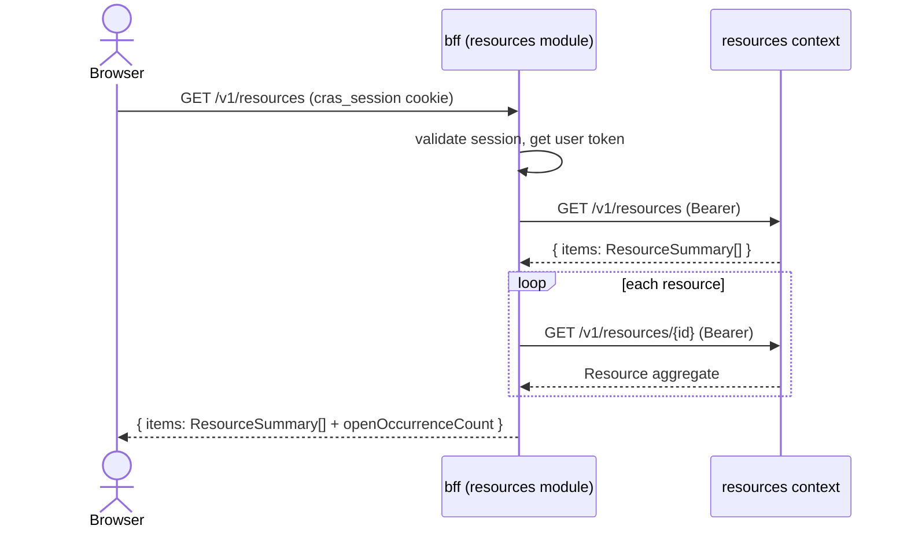

# BFF Resources Module — Read Model and Composition

Module: `backend/bff/src/modules/resources/` (NestJS) · Contract: `bff-openapi.yaml` · Domain: `openapi.yaml`.

The browser never calls the resources context. This module is the browser-facing composition for the Resource zone of UX-S3 and for any other surface that needs resource master data. It owns no aggregate, no table, and no occurrence rule.

## Responsibility

| Owns | Does not own |
|---|---|
| Browser session validation for the resources routes. | Login, token issuance, or cookie refresh; those belong to the shared auth module. |
| Forwarding the user's Bearer token to the resources context. | Resource or Occurrence persistence. |
| The `openOccurrenceCount` read-model field. | Resource `active`, occurrence status, or any domain invariant. |
| Problem+json passthrough and upstream-unavailable mapping. | Availability, occupancy, reservations, or conflict detection. |
| CORS for the frontend origin (BFF-wide). | CORS on the resources context; the context has none. |

## Authentication and transport

- The browser authenticates at `POST /v1/auth/login` in the shared auth module. The BFF stores the session in the `cras_session` cookie: httpOnly, SameSite=Lax, path `/`. The name is a contract placeholder until the auth module fixes it; a rename requires updating `bff-openapi.yaml`.
- The resources module reads the session, obtains the user's access token, and calls the resources context with `Authorization: Bearer <token>`. It strips the browser cookie and does not forward `Origin`.
- The resources context rejects browser `Origin` with 403 `BROWSER_ORIGIN_FORBIDDEN`; the BFF is the only CORS-enabled origin-facing layer.
- If the session is missing or expired, the API returns 401 problem+json; the frontend redirects to UX-LOGIN. If the session role is not `funcionario`, writes return 403; reads are allowed for any of the four realm roles.

## Routes

The browser-facing paths mirror the domain paths exactly:

| Method | Path | BFF behavior |
|---|---|---|
| GET | `/v1/resources` | Calls domain list; composes `openOccurrenceCount` per item. |
| POST | `/v1/resources` | Forwards create; returns 201 + `Location`. |
| GET | `/v1/resources/{resourceId}` | Calls domain aggregate; composes `openOccurrenceCount`. |
| PATCH | `/v1/resources/{resourceId}` | Forwards partial update; returns the updated aggregate. |
| POST | `/v1/resources/{resourceId}/occurrences` | Forwards create; returns 201 + `Location`. |
| PATCH | `/v1/resources/{resourceId}/occurrences/{occurrenceId}` | Forwards the resolve body; returns the resolved occurrence. |

There is no DELETE, reopen, `/inventory-items`, `/availability`, or `/occupancy` route in this module.

## Read-model field

`openOccurrenceCount` is an integer greater than or equal to zero: the number of occurrences of the resource whose status is `OPEN`.

- Present on every `ResourceSummary` in the list and on `Resource` in detail.
- Computed at read time by the BFF from the domain data; it is not persisted and is not part of `openapi.yaml` (the domain contract).
- After a resolve, the next read returns the lower count. The BFF does not cache the value in v1.
- The field is informational. The UI may show it as a badge or warning, but it must never be translated into a reservation block; `active` is the only gate (INV-5, INV-17).
- The BFF does not resolve or display the acting employee beyond passing `reportedBy` and `resolvedBy` through from the domain.

Composition for the list is intentionally simple: read the domain list, then read each resource aggregate to count OPEN occurrences. At lab scale and with no pagination this is acceptable (N+1 reads). A future domain count projection is an optimization, not a contract change. The BFF must not invent a second domain endpoint.

## Response composition

```
ResourceSummary (BFF) = ResourceSummary (domain) + openOccurrenceCount
Resource (BFF)       = Resource (domain) + openOccurrenceCount
Occurrence (BFF)     = Occurrence (domain)
```

No other field is added. In particular, the BFF does not add `salaEfetivaId`, `roomId`, roster, Student data, availability, occupancy, or inventory-item fields. Those belong to other contexts or do not exist.

## Error handling

- Domain problem+json passes through unchanged: status, `type`, `title`, `detail`, `instance`, `code`, `reason`, and `errors[]`.
- The BFF does not translate `FR-22` into a different code. UX-S3 renders the `refusal-banner` from `code`/`reason`/`detail`.
- If the resources context is unreachable or times out, the BFF returns 503 `DEPENDENCY_UNAVAILABLE` with `reason="RESOURCES_UPSTREAM_UNAVAILABLE"`.
- If the identity gateway is unreachable, the BFF returns 503 `DEPENDENCY_UNAVAILABLE` with `reason="IDENTITY_UNAVAILABLE"`.
- The BFF never returns a success envelope around a failure and never adds a `{ "message": ... }` wrapper.



## UX-S3 use

The Resource zone of UX-S3 consumes this module:

1. The resource list uses `GET /v1/resources`; columns include `code`, `name`, `type`, `active`, tags, and `openOccurrenceCount`.
2. Selecting a row uses `GET /v1/resources/{resourceId}`; the detail panel shows the resource fields and the occurrence master-detail list.
3. Create and edit use `POST`/`PATCH /v1/resources`; the code field is editable only on create.
4. Record occurrence uses `POST /v1/resources/{resourceId}/occurrences`; the form exposes description, type, and priority (default `MEDIUM`).
5. Resolve uses `PATCH /v1/resources/{resourceId}/occurrences/{occurrenceId}` with `{resolution}`; the form requires a resolution. No reopen or delete control exists.
6. A 409 or 422 renders the refusal banner; the form is retained. A successful resolve updates the occurrence and the count on the next read and shows `resolvedBy`.

UX-S3 has two zones, Room and Resource. This module covers only the Resource zone. Surface ownership remains OQ-1; the resources group may be assigned a different surface, but the contract above is fixed.

## Tests the module must pass

- List and detail counts equal the number of OPEN occurrences for each resource.
- After resolve, the next count decreases by one; a second resolve returns 409 unchanged.
- A domain 422 (invalid code/tag) and a domain 409 (duplicate code) pass through with the same `code`, `reason`, and `errors[]`.
- A request without `cras_session` returns 401; a read-only role can GET but cannot POST/PATCH.
- No response contains roster, Student, availability, occupancy, or inventory-item fields.
- The BFF does not send `Origin` to the context; a direct browser request to the context is refused.
